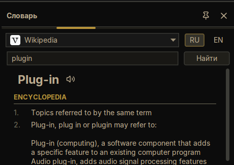

# Wikipedia (RU/EN) for QTranslate

[](https://github.com/davidyaaw/qtranslate-wiki-plugin/releases/latest)
[](https://github.com/topics/qtranslate-plugin)
[](https://github.com/davidyaaw/qtranslate-wiki-plugin/actions/workflows/build.yml)
[](LICENSE)

A QTranslate dictionary plugin that shows the **meaning from the Wikipedia article** — the
article intro, not a search snippet — and lets you switch between the **Russian** and
**English** editions of the same word without leaving the dictionary window.



## Features

- **Article text, not a search hit.** The plugin reads the article intro through the MediaWiki
  `extracts` API. Redirects and title normalisation are handled by MediaWiki itself, so
  «слова» opens «Слово» and «привет» opens «Приветствие».
- **RU / EN switch.** In the dictionary dock, the standalone dictionary window and the
  floating dictionary popup, `RU` and `EN` switch the article already on screen.
- **The right edition by default.** A Cyrillic word opens Russian Wikipedia even when the
  translation pair says English; a Latin word opens English Wikipedia. A manual click always
  wins over this heuristic.
- **Inflected forms reach their lemma.** A search result that differs only in a short case ending
  is accepted, so «сессии» opens «Сессия» and «слова» opens «Слово» even when the title
  normaliser does not bridge them.
- **Did you mean.** When no result is close enough to be the answer, the search candidates are
  shown as suggestions. On the patched host each suggestion is a button that opens its article;
  on a stock host they appear as a normal section.
- **Fallback instead of a wrong article.** If the chosen edition has no article, the other one
  is tried automatically. If neither has one, the dictionary says “not found” rather than
  presenting an unrelated page (for example the film «Некуда бежать» for the verb «бежать»).
- **Wiktionary and Wikimedia Commons included.** The same plugin also provides Wiktionary
  definitions and Commons image search, with no API key.
- **No account, no API key.** Public Wikimedia endpoints only.

## Compatibility

| QTranslate host | Plugin installs | Article-intro lookup | RU / EN switch |
|---|---|---|---|
| 1.5.0, stock (API 2.1.0) | yes | yes | no |
| 1.5.0 + host patch (API 2.2.0) | yes | yes | **yes** |

The switch needs a small host change: stock QTranslate's dictionary window has no concept of a
dictionary offering several editions. The change is in [`host-patch/`](host-patch/README.md),
as a patch against QTranslate `v1.5.0`.

The plugin itself declares `minApiVersion` `2.1.0` and carries a forward-compatible copy of
the optional `LanguageSwitchDictionary` interface. QTranslate's plugin classloader is
parent-first, so:

- on a **stock** host the plugin's copy is used and everything else keeps working;
- on a **patched** host the host's copy is used, so the host recognises the service and shows
  the switch.

## Install

1. Download `wikimedia-reference-<version>.jar` from
   [Releases](https://github.com/davidyaaw/qtranslate-wiki-plugin/releases/latest).
2. Verify its SHA-256 against the value in the release notes (and in
   [`qtranslate-plugin.json`](qtranslate-plugin.json)).
3. In QTranslate: **Settings → Plugins → Install Plugin**, pick the JAR, enable the plugin.
4. In **Settings → Services & Presets**, set **Dictionary → Wikipedia**.
5. To get the `RU` / `EN` switch, apply the host patch from [`host-patch/`](host-patch/README.md)
   and use the rebuilt `app/QTranslate.jar`.

On a stock 1.5.0 host the plugin still installs and improves Wikipedia; only the switch is
absent.

## Use

1. Select a word and press `Ctrl+D` (or open the dictionary from the window).
2. The dictionary shows the article intro with the `RU` / `EN` buttons next to the dictionary
   picker. The current edition is highlighted.
3. Click the other edition to load the same word there. If that edition has no article, the
   plugin falls back to the one that does.

## Build from source

Requires **JDK 21** and the Gradle wrapper (no separate Gradle install).

```bash
./gradlew build          # compile and run the 18 unit tests
./gradlew shadowJar      # build the installable fat JAR
```

The installable artifact is:

```text
build/libs/wikimedia-reference-1.2.0.jar
```

The thin `*-thin.jar` is only a build by-product and is not installable.

The repository commits `libs/qtranslate-api-2.1.0.jar` so the build works without a JitPack
round trip. It is compile-only and is never bundled into the plugin.

## Release

Releases are built by the manual **Release** workflow
(`.github/workflows/release.yml`) or by hand:

```bash
./gradlew clean shadowJar -PpluginVersion=1.2.0
sha256sum build/libs/wikimedia-reference-1.2.0.jar
```

Tag the commit `v<version>`, attach exactly that JAR, and put the SHA-256 in the release
notes. Update [`qtranslate-plugin.json`](qtranslate-plugin.json) with the same version and
hash.

## Project layout

```text
src/main/kotlin/.../plugins/wikimedia/   plugin and services
src/main/kotlin/.../api/dictionary/      forward-compatible optional interface
src/main/resources/                      plugin.json, icons, localization, ServiceLoader
src/test/kotlin/                         tests and HTTP/plugin test doubles
libs/qtranslate-api-2.1.0.jar            compile-only host API
host-patch/                              optional host patch for the RU/EN switch
docs/wikipedia-ru-en.png                 screenshot
qtranslate-plugin.json                   catalog metadata for a future QTranslate index
```

## Topics

The repository is tagged with
[`qtranslate-plugin`](https://github.com/topics/qtranslate-plugin),
[`qtranslate`](https://github.com/topics/qtranslate), `wikipedia`, `wiktionary`,
`dictionary`, `kotlin`, `mediawiki` and `translation`.

## Licence and provenance

The repository is distributed under the **Mozilla Public License 2.0** (`LICENSE`), the
same licence as QTranslate itself.

Substantial parts of the plugin source are derived from QTranslate's
`plugins/wikimedia-reference` module at `v1.5.0`, Copyright (c) 2023–2026 Ahmed Hatem and
QTranslate contributors, also under MPL-2.0. Files carry an
`SPDX-License-Identifier: MPL-2.0` header. See [`NOTICE.md`](NOTICE.md) and
[`LICENSES/MPL-2.0.txt`](LICENSES/MPL-2.0.txt).

Article text and images are fetched from Wikimedia projects at runtime and are not
redistributed by this plugin.

## Русский — кратко

Плагин показывает **значение из статьи Википедии** (вводный текст, а не сниппет поиска) и
даёт кнопки **RU / EN** в окне словаря. Русское слово по умолчанию открывается в русской
Википедии, английское — в английской. Если в одном языке статьи нет, плагин показывает
второй; если нет нигде — честное «не найдено».

Установка: Release → `wikimedia-reference-1.2.0.jar` → **Settings → Plugins → Install
Plugin** → включить → **Dictionary → Wikipedia**.

Кнопки RU/EN требуют пропатченного хоста: см. [`host-patch/README.md`](host-patch/README.md).
На стоковом QTranslate 1.5.0 плагин тоже работает и улучшает поиск, но переключателя в
интерфейсе нет.
